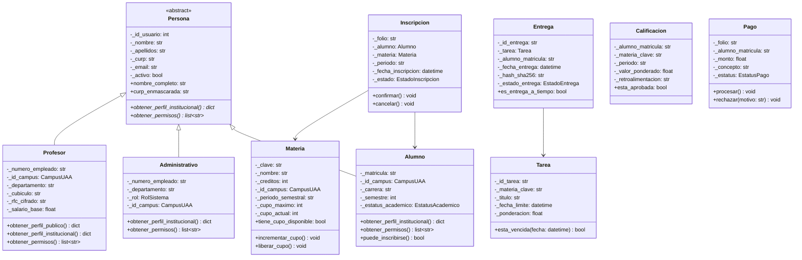

# Reporte Técnico — Segunda Entrega: E-SIIMA Killer (E-SIIMA 3)

**Universidad Autónoma de Aguascalientes (UAA)**  
**Centro de Ciencias Básicas — Proyecto Integrador de Sistemas Computacionales**

- **Integrantes del Equipo:**
  - Francisco Javier Sánchez Vallin (`@FranciscoJavierSV`) — Líder del Proyecto / Full Stack & PostgreSQL Distribuido
  - Gael Emiliano Nefarole López (`@Gael1435`) — Full Stack / DevOps, Docker, CI/CD & Analítica MongoDB
  - Ángel Azael Fajardo Espino (`@AzaelFajardo`) — Frontend Multiplataforma Flutter & Co-diseño API REST
- **Profesores Evaluadores:**
  - Dr. David Montoya (`dr.davidmontoya.dcat@gmail.com`)
  - Prof. Gerardo Salazar (`gerardo.salazar@edu.uaa.mx`)
  - Prof. Irving Cardona (`@Irving2355`)
- **Repositorio Oficial:** https://github.com/esimma-killer/esimma-killer

---

## 1. Estrategia de Trabajo Colaborativo en Git (Issue #15)

Para garantizar trazabilidad, revisiones ordenadas y cero regresiones en la rama principal (`main`), se implementaron:
- **Guía de Contribución (`CONTRIBUTING.md`):** Define el flujo de ramas por issue (`docs/issue-X-...`, `feat/issue-X-...`, `devops/issue-X-...`, `test/issue-X-...`) y el uso obligatorio de **Conventional Commits** (`feat:`, `fix:`, `docs:`, `test:`, `ci:`, `build:`).
- **Plantilla de Pull Request (`.github/pull_request_template.md`):** Exige la vinculación del issue (`Closes #N`), la verificación de PEP 8 (`ruff`), pruebas unitarias con cobertura `>= 60%` (`pytest`), análisis de seguridad (`bandit`, `pip-audit`) y la declaración explícita de transparencia sobre el uso de herramientas de Inteligencia Artificial.

---

## 2. Arquitectura Modular del Backend y Cumplimiento PEP 8 (Issue #7)

El backend en Python 3.11+ se estructuró bajo una arquitectura limpia por capas dentro del directorio `backend/`, separando el dominio de negocio de los detalles de transporte HTTP:

```text
backend/
├── .env.example
├── pyproject.toml
├── requirements.txt
├── requirements-dev.txt
├── src/
│   ├── __init__.py
│   ├── main.py                  # Punto de entrada FastAPI, CORS y manejadores de errores
│   ├── core/
│   │   ├── __init__.py
│   │   └── config.py            # Configuración de entorno y definición de Shards por id_campus
│   ├── domain/
│   │   ├── __init__.py
│   │   ├── enums.py             # Enumeraciones tipadas (CampusUAA, RolSistema, etc.)
│   │   ├── exceptions.py        # Jerarquía de excepciones personalizadas del dominio
│   │   ├── personas.py          # Jerarquía POO: Persona (ABC), Alumno, Administrativo, Profesor
│   │   ├── academico.py         # Entidades: Materia, Inscripcion, Tarea, Entrega, Calificacion
│   │   └── finanzas.py          # Entidad: Pago (simulado)
│   ├── services/
│   │   ├── __init__.py
│   │   ├── inscripcion_service.py # Reglas de negocio y bloque try-except-else-finally
│   │   └── pago_service.py        # Procesamiento de pagos simulados y auditoría
│   └── api/
│       ├── __init__.py
│       ├── schemas.py           # Contratos Pydantic v2 de entrada/salida
│       └── routers/
│           ├── __init__.py
│           ├── health.py        # Monitoreo de salud (/api/v1/health)
│           ├── informacion.py   # Portal Institucional UAA (avisos, calendario, campus)
│           ├── academico.py     # Endpoints de alumnos, materias, inscripciones y entregas
│           └── pagos.py         # Endpoints de pagos simulados
└── tests/
    ├── __init__.py
    └── conftest.py
```

### Justificación de Diseño Modular
- **Separación de Responsabilidades (SRP):** `src/domain/` no depende de FastAPI ni de librerías externas; contiene únicamente reglas y entidades de negocio puras.
- **Prevención de Referencias Circulares:** El flujo de dependencias es estrictamente unidireccional (`api` $\rightarrow$ `services` $\rightarrow$ `domain` $\leftarrow$ `core`).
- **Adherencia a PEP 8:** Se configuró `ruff` en `pyproject.toml` con validación de estilo (`E`, `W`), Pyflakes (`F`), ordenamiento de imports (`I`), convenciones de nombres PEP 8 (`N`) y detección de malas prácticas (`B`).

---

## 3. Modelo de Clases POO, Principios SOLID y Type Hints (Issue #8)

El modelo de objetos implementa las clases requeridas por la rúbrica (`Persona`, `Alumno`, `Administrativo`, `Materia`, `Inscripcion`, `Calificacion`, `Pago`) e integra los elementos arquitectónicos de la **Propuesta Técnica** (`Profesor` con fragmentación vertical de datos sensibles, `Tarea`, `Entrega` con hash SHA-256 y la llave de particionamiento horizontal `id_campus`).

### Diagrama de Clases Implementado



### Aplicación de Pilares POO y Principios SOLID
1. **Abstracción y Herencia (`Persona`):** `Persona` hereda de `ABC` y define métodos abstractos (`obtener_perfil_institucional()` y `obtener_permisos()`) que obligan a cada subclase (`Alumno`, `Administrativo`, `Profesor`) a definir su representación y control de acceso.
2. **Encapsulamiento y Protección de PII:** Todos los atributos internos son privados (`_nombre`, `_curp`, `_email`, `_cupo_maximo`, `_monto`) y se exponen mediante `@property` y *setters* con validación. Además, `Persona.curp_enmascarada` y `Profesor.obtener_perfil_publico()` ocultan información sensible (CURP, RFC, salario) en consultas generales, reflejando en objetos la fragmentación vertical de la base de datos.
3. **Polimorfismo (Liskov Substitution Principle - LSP):** Cualquier función que opere sobre una lista `list[Persona]` puede invocar `persona.obtener_perfil_institucional()` o `persona.obtener_permisos()` obteniendo el comportamiento específico según sea `Alumno`, `Administrativo` o `Profesor`.
4. **Abierto/Cerrado (OCP) e Inversión de Dependencias (DIP):** Se pueden agregar nuevos tipos de usuario heredando de `Persona` sin modificar los servicios existentes.

---

## 4. Jerarquía de Excepciones y Manejo de Errores con `try-except-else-finally` (Issue #9)

### Jerarquía de Excepciones del Dominio (`src/domain/exceptions.py`)
Todas las excepciones de negocio heredan de `DominioError(Exception)`, la cual encapsula `mensaje`, `codigo_error` y un diccionario estructurado `detalles`:
- `DominioError` *(Base)*
  - `ValidacionDominioError`: Datos fuera de rango o formato inválido (ej. calificación fuera de `0.0 - 10.0`, CURP inválida, créditos negativos).
  - `RecursoNoEncontradoError`: Entidad solicitada inexistente (`Alumno`, `Materia`, `Inscripcion`, `Pago`).
  - `InscripcionInvalidaError`: Violación de reglas de negocio al inscribir (materia sin cupo disponible, alumno con estatus inactivo/baja, discordancia de `id_campus` entre alumno y materia, o inscripción duplicada).
  - `PagoRechazadoError`: Falla en el procesamiento del pago simulado (fondos insuficientes simulados, monto menor o igual a cero, o pago previamente procesado).

### Patrón `try - except - else - finally` en Servicios (`src/services/`)
En `InscripcionService.inscribir_alumno()` y `PagoService.procesar_pago()` se implementa el flujo completo de cuatro bloques:
1. **`try`:** Ejecuta las validaciones de precondiciones (estatus del alumno, coincidencia de shard `id_campus`, disponibilidad de cupo o validez de fondos) e instancia la transacción.
2. **`except`:** Captura excepciones de validación o errores inesperados de bajo nivel y los traduce/propaga como `InscripcionInvalidaError` o `PagoRechazadoError` con metadatos claros, evitando fugas de trazas internas.
3. **`else`:** Se ejecuta **únicamente si no ocurrió ninguna excepción** en el `try`; confirma la inscripción o el pago, incrementa el cupo ocupado en la materia y prepara el recibo de confirmación.
4. **`finally`:** Se ejecuta **siempre** (tanto en éxito como en fallo) para registrar un evento inmutable en la bitácora de auditoría con la estructura de la colección `logs_actividad` de MongoDB (`id_usuario`, `rol`, `campus`, `accion`, `ip_origen`, `timestamp`, `resultado`).

---

## 5. API REST en FastAPI, CORS y Contratos OpenAPI (Issue #10)

La capa HTTP en `src/main.py` expone los servicios de negocio mediante routers modulares bajo el prefijo `/api/v1`:
- **`GET /api/v1/health`:** Verifica la disponibilidad de la API y reporta el estado de los shards (`id_campus=1` Campus Central y `id_campus=2` Campus Sur).
- **`GET /api/v1/informacion`:** Alimenta el **Portal Institucional UAA (Landing Page)** con avisos por campus, calendario escolar y oferta educativa.
- **`/api/v1/academico/*`:** Endpoints demostrativos para registro y consulta de `Alumno`, `Materia`, `Inscripcion`, `Tarea`/`Entrega` (con cálculo de hash SHA-256) y `Calificacion`.
- **`/api/v1/pagos/*`:** Endpoints para simulación de `Pago` y verificación de manejo de `PagoRechazadoError`.
- **Documentación Interactiva:** Disponible automáticamente en `/docs` (Swagger UI) y `/redoc`.

---

## 6. Justificación de la Postura CAP y Cumplimiento Legal LFPDPPP / Tríada CIA

*(Sección comprometida en las páginas 12, 14 y 15 de la Propuesta Técnica de la Primera Entrega).*

### 6.1. Justificación Formal de la Postura CAP por Tipo de Operación
En un sistema distribuido con particionamiento horizontal por campus (`id_campus = 1` Nodo Local Campus Central, `id_campus = 2` Nodo Remoto Campus Sur) y réplicas de lectura asíncronas, el teorema CAP obliga a elegir entre **Consistencia (C)** y **Disponibilidad (A)** ante particiones o latencia de red:

| Flujo / Operación | Nodos Involucrados | Postura CAP | Justificación Técnica y Académica |
| :--- | :--- | :---: | :--- |
| **Inscripciones, Subida de Entregas y Registro de Calificaciones** | Nodo Maestro del Campus correspondiente (`id_campus`) | **CP (Consistencia + Tolerancia a Particiones)** | Una entrega con fecha límite a las 23:59, el control de cupo máximo de una materia o el asentamiento de una calificación final no admiten lecturas sucias ni pérdida de actualizaciones (*lost updates*). Toda escritura va directo al primario de su campus. |
| **Portal Institucional UAA (Landing Page, Carteleras, Avisos y Calendario)** | Réplicas de Solo Lectura por Campus | **AP (Disponibilidad + Tolerancia a Particiones)** | El público general y los alumnos que consultan avisos o fechas del calendario escolar requieren respuesta inmediata incluso durante picos masivos de tráfico. Es aceptable una consistencia eventual con desfase de segundos en avisos informativos. |
| **Telemetría y Logs de Actividad (`logs_actividad`)** | Cola de Eventos $\rightarrow$ MongoDB Replica Set | **AP (Asíncrono)** | El registro de telemetría para las gráficas analíticas de Matplotlib no debe bloquear ni degradar el tiempo de respuesta de la transacción académica del alumno. |

### 6.2. Cumplimiento Legal (LFPDPPP) y Controles de la Tríada CIA
El sistema procesa datos que en un entorno real están regulados por la **Ley Federal de Protección de Datos Personales en Posesión de los Particulares (LFPDPPP)** y normativas universitarias de protección de datos:

1. **Principio de Minimización y Datos Sintéticos:** Durante todo el desarrollo y pruebas del proyecto se utilizan exclusivamente **datos sintéticos generados algorítmicamente**. Ninguna matrícula, CURP, RFC o nombre corresponde a una persona real.
2. **Confidencialidad (Aislamiento Vertical y Encapsulamiento):**
   - Los datos patrimoniales y sensibles de los docentes (`rfc_cifrado`, `curp_cifrada`, `salario_base`, `cuenta_bancaria`) están separados verticalmente de `profesores_publico`.
   - En la capa POO (`Persona` y `Profesor`), las propiedades públicas enmascaran la CURP (`curp_enmascarada`) y el método `obtener_perfil_publico()` excluye cualquier atributo financiero o fiscal.
3. **Integridad (Validación Pydantic + Hash SHA-256):**
   - Todos los payloads HTTP son validados estrictamente con esquemas Pydantic antes de tocar la capa de servicios.
   - La entidad `Entrega` calcula y almacena el **hash criptográfico SHA-256** del contenido entregado junto con su marca de tiempo (`fecha_entrega`), impidiendo la alteración silenciosa de archivos o fechas de entrega.
4. **Disponibilidad (Desacoplamiento por `id_campus` y Healthchecks):**
   - El enrutamiento por `id_campus` aísla la carga del Campus Central respecto al Campus Sur, y el endpoint `/api/v1/health` permite a Docker y al balanceador monitorear el estado del servicio en tiempo real.

---

## 7. Evidencia de Pruebas Unitarias (`pytest`) y Cobertura `>= 60%` (Issue #11)

> [!NOTE]
> *Esta sección se completará con la salida exacta de terminal y el reporte de cobertura al ejecutar el Paso 6 (Issue #11) y el cierre en el Paso 10.*

- **Comando de verificación:**
  ```bash
  pytest --cov=src --cov-report=term-missing --cov-fail-under=60
  ```
- **Resumen de resultados:** *(Pendiente de adjuntar en Paso 6 / Paso 10).*

---

## 8. Evidencia de Integración Continua (GitHub Actions) y Contenedores Docker (Issues #12 y #13)

> [!NOTE]
> *Esta sección se completará con los enlaces y capturas del pipeline de GitHub Actions (`Ruff`, `Pytest`, `Bandit`, `Pip-Audit`) y pruebas de `docker compose up` en los Pasos 7, 8 y 10.*

---

## 9. Declaración y Bitácora de Uso Responsable de Inteligencia Artificial (Anexo A)

En cumplimiento con el punto 4 de la **Carta Compromiso sobre el Uso de Inteligencia Artificial** firmada el 10 de noviembre de 2026 (*"Indicaremos de forma clara en el repositorio de GitHub y en los documentos qué partes se hicieron con ayuda de IA"*):

- **Herramientas utilizadas:** Google Antigravity (Gemini) y Claude (Anthropic).
- **Garantía de privacidad (LFPDPPP):** No se compartieron datos personales reales de alumnos o docentes de la UAA ni credenciales/llaves de acceso. Todo el código y ejemplos emplean datos sintéticos.
- **Validación humana:** Cada integrante revisó, probó y puede explicar y defender de manera individual el funcionamiento de cada módulo.

### Bitácora Detallada de Apoyo con IA por Paso e Issue

| Paso / Issue | Archivos Involucrados | Qué se realizó con apoyo de IA (Antigravity / Gemini) | Revisión y Validación del Equipo |
| :--- | :--- | :--- | :--- |
| **Paso 1 — Issue #15** (`[E2-DOCS]`) | `.github/pull_request_template.md`, `CONTRIBUTING.md`, `docs/entregas/segunda_entrega.md` | Redacción de estructura base para la plantilla de PR, formato de convenciones de ramas (*Conventional Commits*), diagrama Mermaid de clases POO y redacción estructurada de la justificación CAP y controles LFPDPPP/CIA a partir de la Propuesta Técnica. | Revisión contra los compromisos de la Primera Entrega (`Propuesta_E-SIIMA_Killer.pdf`) y ajuste de roles/épicas del equipo. |
| **Paso 2 — Issue #7** (`[E2-BACKEND]`) | `backend/pyproject.toml`, `backend/requirements*.txt`, `backend/.env.example`, `backend/src/core/config.py`, `__init__.py` | Generación del andamiaje modular de paquetes (`core`, `domain`, `services`, `api`), configuración de reglas PEP 8 en `ruff`, umbrales de `pytest-cov` (`>= 60%`) y clase `Settings` con resolución de metadatos de *Shard Key* (`id_campus`). | Verificación de estructura de directorios sin referencias circulares, separación de dependencias (`prod` vs `dev`) y exclusión de `.env` en `.gitignore`. |
| **Paso 3 — Issue #8** (`[E2-POO]`) | `backend/src/domain/enums.py`, `personas.py`, `academico.py`, `finanzas.py`, `__init__.py` | Implementación asistida de la jerarquía `Persona` (ABC), `Alumno`, `Administrativo`, `Profesor`, `Materia`, `Inscripcion`, `Calificacion`, `Tarea`, `Entrega` (con hash SHA-256) y `Pago` con `@property`, *Type Hints* y *Shard Key* `id_campus`. | Revisión de polimorfismo (`obtener_perfil_institucional`, `obtener_permisos`), enmascaramiento de CURP/datos sensibles (LFPDPPP) y reglas de negocio de cupos/entregas. |
| **Paso 4 — Issue #9** (`[E2-BACKEND]`) | `backend/src/domain/exceptions.py`, `backend/src/services/inscripcion_service.py`, `pago_service.py`, `__init__.py` | Diseño asistido de la jerarquía `DominioError`, `ValidacionDominioError`, `RecursoNoEncontradoError`, `InscripcionInvalidaError` y `PagoRechazadoError`, junto con los bloques completos `try-except-else-finally` y emisión de eventos `logs_actividad` en `finally`. | Verificación de las 4 ramas de ejecución (`try`, `except`, `else`, `finally`), encadenamiento de excepciones (`raise ... from exc`) y formato de telemetría para MongoDB. |
| **Paso 5 — Issue #10** (`[E2-API]`) | `backend/src/main.py`, `backend/src/api/schemas.py`, `dependencies.py`, `backend/src/api/routers/health.py`, `informacion.py`, `academico.py`, `pagos.py` | Estructuración asistida de esquemas Pydantic v2, routers modulares (`/api/v1/health`, `/informacion`, `/academico`, `/pagos`), configuración de `CORSMiddleware` y manejadores globales de `DominioError` (`400` y `404`). | Validación de respuestas HTTP (`200`, `201`, `400`, `404`, `422`), generación del contrato OpenAPI (`/openapi.json` y `/docs`) y apego a PEP 8 (`ruff`). |
