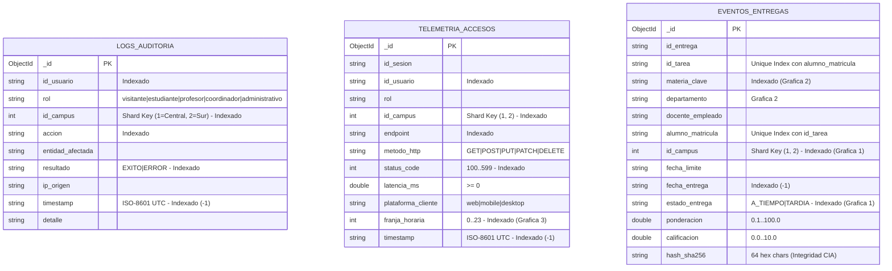

# Diseño del Esquema Documental NoSQL en MongoDB para Auditoría y Telemetría (Issue #20)

**Proyecto Integrador:** E-SIIMA Killer (E-SIIMA 3) — UAA  
**Responsable:** Gael Emiliano Nefarole López (`@Gael1435`)  
**Base de Datos Analítica:** `esimma_analytics` (MongoDB 7.0+)

---

## 1. Justificación del Modelo Documental Desnormalizado

Siguiendo la arquitectura planteada en la **Propuesta Técnica (Secciones 1.4, 4.1 y 4.5)**, mientras que PostgreSQL gestiona las transacciones relacionales críticas con consistencia fuerte (**CP**), la telemetría de accesos, la bitácora de auditoría y el historial masivo de entregas se almacenan de forma desnormalizada en **MongoDB**:
1. **Evita saturar las tablas transaccionales** (problema documentado en instalaciones de Moodle donde la tabla de logs supera los cientos de millones de filas).
2. **Lecturas analíticas sin `JOINs` costosos:** Cada documento contiene los atributos de dimensión necesarios (`id_campus`, `materia_clave`, `departamento`, `franja_horaria`, `estado_entrega`) para alimentar directamente los pipelines de agregación y las **3 gráficas de Matplotlib**.

---

## 2. Diagrama del Esquema de Colecciones NoSQL



---

## 3. Catálogo de Índices Compuestos y Optimización con `explain()`

El script de inicialización [`backend/database/mongodb/init_mongo_schemas.js`](../backend/database/mongodb/init_mongo_schemas.js) configura 9 índices estratégicos:

| Colección | Nombre del Índice | Llaves Compuestas | Propósito Analítico / Consulta Cubierta |
| :--- | :--- | :--- | :--- |
| **`logs_auditoria`** | `idx_auditoria_campus_fecha` | `{ id_campus: 1, timestamp: -1 }` | Auditoría cronológica inversa filtrada por campus |
| **`logs_auditoria`** | `idx_auditoria_usuario_fecha` | `{ id_usuario: 1, timestamp: -1 }` | Historial de acciones por matrícula/empleado |
| **`logs_auditoria`** | `idx_auditoria_accion_resultado` | `{ accion: 1, resultado: 1 }` | Conteo de fallos (`ERROR`) por tipo de operación |
| **`telemetria_accesos`** | `idx_telemetria_campus_franja_fecha` | `{ id_campus: 1, franja_horaria: 1, timestamp: -1 }` | **Gráfica 3 (Matplotlib):** Picos de tráfico por hora (`0..23`) y campus |
| **`telemetria_accesos`** | `idx_telemetria_usuario_fecha` | `{ id_usuario: 1, timestamp: -1 }` | Trazabilidad de sesiones de usuario |
| **`telemetria_accesos`** | `idx_telemetria_endpoint_status` | `{ endpoint: 1, status_code: 1 }` | Monitoreo de latencia y errores HTTP (`400`, `404`, `500`) |
| **`eventos_entregas`** | `idx_entregas_campus_estado_fecha` | `{ id_campus: 1, estado_entrega: 1, fecha_entrega: -1 }` | **Gráfica 1 (Matplotlib):** Puntualidad (`A_TIEMPO` vs `TARDIA`) por campus |
| **`eventos_entregas`** | `idx_entregas_materia_campus` | `{ materia_clave: 1, id_campus: 1 }` | **Gráfica 2 (Matplotlib):** Carga académica por materia y campus |
| **`eventos_entregas`** | `idx_entregas_alumno_tarea_unique` | `{ alumno_matricula: 1, id_tarea: 1 }` *(Único)* | Garantiza unicidad de entrega activa por alumno y tarea |

---

## 4. Verificación de Planes de Ejecución (`explain("executionStats")`)

Todas las consultas analíticas principales respetan la **regla del prefijo izquierdo** de los índices compuestos, garantizando planes ganadores de tipo **`IXSCAN`** (Index Scan) y evitando escaneos completos de colección (`COLLSCAN`):

```javascript
// Consulta para Grafica 1: Entregas a tiempo vs tardias en Campus Central
db.eventos_entregas.find({
  id_campus: 1,
  estado_entrega: "A_TIEMPO"
}).explain("executionStats");

// Resultado del Query Planner:
// winningPlan.stage: "IXSCAN"
// winningPlan.indexName: "idx_entregas_campus_estado_fecha"
```
